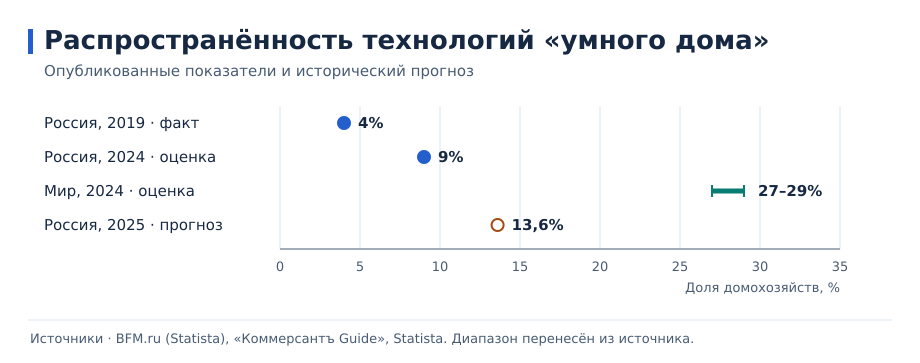
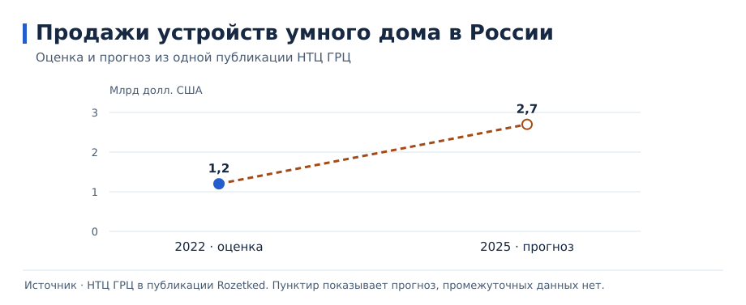
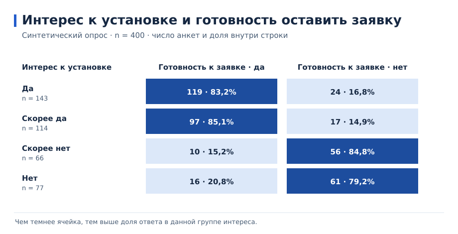
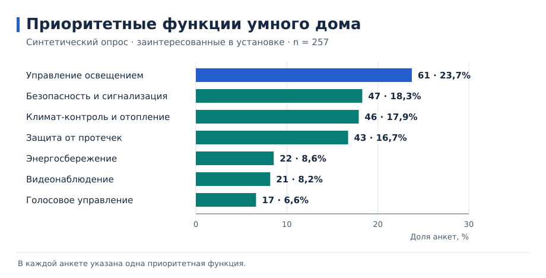
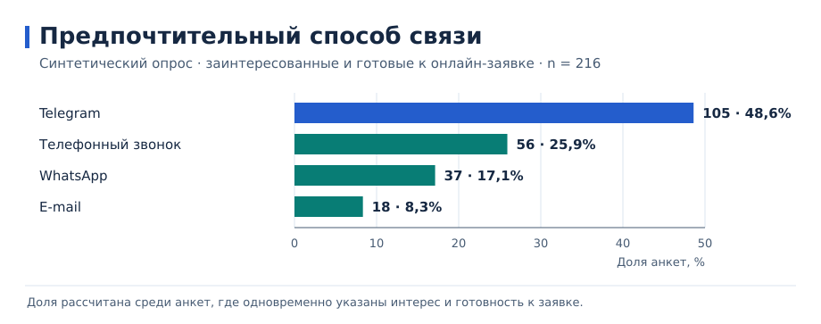
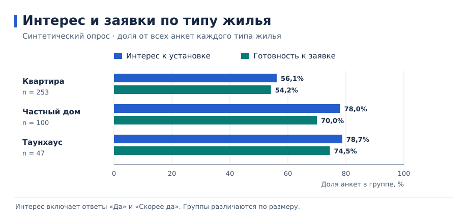
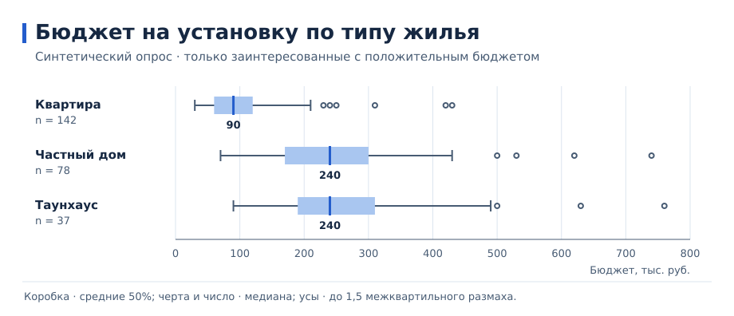

# Анализ данных для сайта «Умный дом»

**Цель.** Описать контекст рынка в России и на учебной модели проверить, какие услуги, поля заявки и варианты связи стоит предусмотреть на сайте компании по монтажу систем «Умный дом».

## Данные и методика

- [Показатели рынка](../data/smart_home_market_russia.csv) — 18 записей за 2013–2025 годы из открытых публикаций. Для графиков выбраны доля домохозяйств и оценки продаж устройств. Показатели с разным охватом, периодом или единицами (услуги и устройства, полугодие и год, рубли и доллары, продажи одной компании и всего рынка) не объединялись в общий ряд.
- [Синтетический опрос](../data/potential_clients_survey_synthetic.csv) — 400 сгенерированных анкет, 400 уникальных идентификаторов, пропусков нет. Квартиры составляют 253 анкеты, частные дома — 100, таунхаусы — 47. Возраст в модели — 18–70 лет, медиана 36 лет. У 194 из 400 анкет (48,5%) указаны имеющиеся умные устройства. Такой состав описывает учебный набор и не позволяет оценить реальный спрос в Иркутске, конверсию будущего сайта или выручку.
- Интерес к установке — ответы «Да» и «Скорее да». Доля готовых оставить заявку считается по отдельному вопросу. Проценты на графиках рассчитаны от подписанной группы. Бюджеты сравниваются среди заинтересованных с положительной суммой. Во входных данных это все 257 заинтересованных анкет.

## Рынок

В 2024 году долю домохозяйств с технологиями умного дома оценивали примерно в **9% в России и 27–29% в мире**. Разница по опубликованным оценкам — **18–20 процентных пунктов**. В публикации за 2020 год для России приведена доля около 4% за 2019 год. Значения за 2019 и 2024 годы пришли из разных источников с неизвестной сопоставимостью методик. Значение 13,6% на 2025 год — исторический прогноз Statista. [BFM.ru](https://www.bfm.ru/news/457991) · [«Коммерсантъ Guide»](https://iv.kommersant.ru/ISSUES.PDF/REGIONS/PITER_TEMA2/2025/0061/02T006.PDF)

Оценка продаж устройств в 2022 году составила **1,2 млрд долл.**, прогноз на 2025 год — **2,7 млрд долл.** Прогноз был в 2,25 раза выше исходной оценки. Это ожидание аналитиков на момент публикации. В CSV отсутствует наблюдение фактических продаж за 2025 год. Стоимость монтажа по этим цифрам определить нельзя. [Rozetked](https://rozetked.me/news/21995-roskomnadzor-rossiyskiy-rynok-ustroystv-umnogo-doma-vyrastet-vdvoe-k-2025-godu)

В 2025 году **92% российских домохозяйств** имели доступ к интернету. Это контекст для сайта с онлайн-заявкой. Готовность пользоваться формой в целевом регионе требует отдельной проверки. [ИСИЭЗ НИУ ВШЭ](https://issek.hse.ru/mirror/pubs/share/1143575343)

## Учебная модель клиентских предпочтений

### Установка и онлайн-заявка

**257 из 400 (64,25%)** заинтересованы в установке, **242 из 400 (60,5%)** готовы оставить заявку, **216 из 400 (54,0%)** ответили положительно на оба вопроса. Среди заинтересованных готовы к заявке 216 из 257 (84,0%), среди остальных — 26 из 143 (18,2%). Для сайта это основание проверить простой сценарий заявки на расчёт стоимости. Ответы в учебном наборе описывают намерения в модели.

### Услуги и каналы связи

Управление освещением выбрали **61 из 257 (23,7%)** заинтересованных. Следом идут безопасность и сигнализация (47; 18,3%), климат-контроль и отопление (46; 17,9%), защита от протечек (43; 16,7%). Для прототипа эти четыре направления можно вывести в каталог услуг. Разница между вторым и третьим местом — одна анкета.

Среди 216 заинтересованных и готовых к заявке **105 выбрали Telegram (48,6%)**, **56 — звонок (25,9%)**, 37 — WhatsApp (17,1%), 18 — электронную почту (8,3%). Telegram — самый частый вариант. Для формы имеет смысл предусмотреть выбор канала с Telegram и звонком среди вариантов. Предпочтение клиента касается обратной связи. Уведомление компании через Telegram Bot API — отдельная техническая функция сайта.

### Тип жилья и бюджет

В модели интерес составляет **56,1%** в квартирах (142 из 253), **78,0%** в частных домах (78 из 100) и **78,7%** в таунхаусах (37 из 47). Квартиры при этом дают больше всего заинтересованных анкет по числу. Доля готовых к заявке составляет соответственно **54,2%, 70,0% и 74,5%**. У таунхаусов самая малочисленная группа, поэтому близкие доли домов и таунхаусов не дают основания выделять лидера среди реальных клиентов.

| Тип жилья | Анкет с положительным бюджетом | Медиана, тыс. руб. | Средние 50%, тыс. руб. |
| --- | ---: | ---: | ---: |
| Квартира | 142 | 90 | 60–120 |
| Частный дом | 78 | 240 | 170–300 |
| Таунхаус | 37 | 240 | 190–310 |

Медиана по всем 257 заинтересованным — **130 тыс. руб.** Различия внутри учебного набора поддерживают идею указать в заявке тип жилья, площадь и нужные функции. Перед публикацией цен нужны реальные сметы, а перед оценкой спроса — фактические заявки или опрос потенциальных клиентов.
